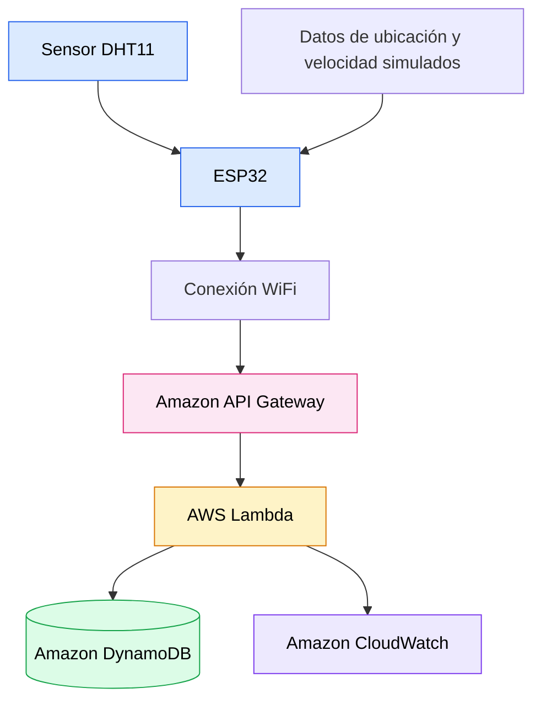

# 📦 Sistema de Monitoreo de Envíos con ESP32 y AWS

## 1. Descripción del proyecto

Este proyecto consiste en un sistema de monitoreo de envíos que permite recopilar, transmitir y almacenar información relacionada con las condiciones ambientales y la ubicación de un vehículo durante el transporte de mercancías.

El sistema utiliza un microcontrolador **ESP32** conectado a un sensor de temperatura y humedad DHT11. Los datos recopilados se transmiten mediante una conexión WiFi hacia una infraestructura en la nube implementada con servicios de Amazon Web Services (AWS).

La información es recibida mediante Amazon API Gateway, procesada por una función AWS Lambda y almacenada en una tabla de Amazon DynamoDB.

El objetivo es establecer una infraestructura IoT que permita monitorear las condiciones de un envío y conservar un historial de sus mediciones.

---

## 2. Arquitectura del proyecto

La arquitectura está basada en un modelo de comunicación IoT en el que un dispositivo físico recopila información y la transmite a servicios de computación en la nube.

### Diagrama de arquitectura



### Componentes de la arquitectura

| Componente | Tecnología | Función |
|---|---|---|
| Microcontrolador | ESP32 | Recopila los datos y administra la comunicación WiFi. |
| Sensor ambiental | DHT11 | Obtiene las mediciones de temperatura y humedad. |
| Comunicación inalámbrica | WiFi | Permite transmitir los datos hacia Internet. |
| API de recepción | Amazon API Gateway | Recibe las solicitudes HTTP POST del ESP32. |
| Procesamiento | AWS Lambda | Valida, procesa y prepara los datos para almacenarlos. |
| Base de datos | Amazon DynamoDB | Almacena los registros de monitoreo. |
| Registro de actividad | Amazon CloudWatch | Permite consultar los registros de ejecución de Lambda. |

---

## 3. Funcionamiento del sistema

El funcionamiento se divide en las siguientes etapas:

### 3.1. Captura de información

El ESP32 obtiene información del sensor DHT11, que proporciona dos variables ambientales:

- Temperatura en grados Celsius (°C).
- Humedad relativa en porcentaje (%).

También incorpora información relacionada con el envío:

- Identificador del dispositivo.
- Identificador del envío.
- Fecha y hora de la medición.
- Latitud.
- Longitud.
- Velocidad del vehículo.

Actualmente, los datos de latitud, longitud y velocidad son valores simulados. Se contempla incorporar un módulo GPS para obtener estas mediciones de manera real.

### 3.2. Preparación de los datos

El ESP32 organiza la información obtenida en un objeto JSON.

Ejemplo del formato transmitido:

```json
{
  "device_id": "AGT-ESP32-001",
  "shipment_id": "ENV-2026-001",
  "timestamp": "2026-11-19T01:45:35Z",
  "temperature_c": 28.8,
  "humidity_pct": 72.0,
  "latitude": 19.236500,
  "longitude": -104.703201,
  "speed_kmh": 45.2
}
```

El campo `timestamp` se obtiene mediante un servicio NTP, utilizando la hora UTC.

### 3.3. Transmisión mediante WiFi

Una vez construido el JSON, el ESP32 utiliza las bibliotecas `WiFiClientSecure` y `HTTPClient` para establecer una conexión HTTPS.

Los datos se envían mediante una petición HTTP POST hacia el endpoint de Amazon API Gateway.

**Endpoint de recepción:**

```text
POST /etapa1/recepcionDeDatos
```

### 3.4. Recepción mediante Amazon API Gateway

Amazon API Gateway funciona como punto de entrada para las solicitudes del dispositivo IoT.

Sus responsabilidades son:

- Recibir las solicitudes HTTPS.
- Identificar la ruta solicitada.
- Ejecutar la integración con AWS Lambda.
- Devolver la respuesta generada por Lambda.

### 3.5. Procesamiento mediante AWS Lambda

La función Lambda `recepcionDeDatos` recibe la información enviada por API Gateway.

Sus principales responsabilidades son:

1. Interpretar el contenido JSON de la solicitud.
2. Validar los campos requeridos.
3. Procesar la información del dispositivo.
4. Generar el identificador del registro.
5. Guardar la información en DynamoDB.
6. Devolver una respuesta HTTP indicando el resultado de la operación.

### 3.6. Almacenamiento en Amazon DynamoDB

Amazon DynamoDB es el servicio utilizado para almacenar las mediciones recibidas.

Cada registro conserva información relacionada con el dispositivo, el envío, las condiciones ambientales, la ubicación y la velocidad.

El identificador del registro utiliza una estructura similar a:

```text
ENV-2026-001#2026-11-19T01:45:35Z
```

Esta estructura permite asociar la medición con un envío y su momento de captura.

---

## 4. Tecnologías utilizadas

### Hardware

- ESP32.
- Sensor DHT11.
- Conexión WiFi.
- Módulo GPS NEO-6M (contemplado para una futura integración).

### Software y servicios

| Tecnología | Uso |
|---|---|
| Arduino IDE | Desarrollo y carga del programa en el ESP32. |
| C++ | Programación del microcontrolador. |
| JSON | Formato de intercambio de información. |
| HTTPS | Comunicación segura mediante TLS. |
| NTP | Sincronización de fecha y hora. |
| Amazon API Gateway | Recepción de solicitudes HTTP. |
| AWS Lambda | Procesamiento de información. |
| Amazon DynamoDB | Almacenamiento de registros. |
| Amazon CloudWatch | Monitoreo y consulta de registros de ejecución. |

---

## 5. Configuración del hardware

### Conexión del sensor DHT11

La conexión utilizada para el sensor DHT11 es la siguiente:

| DHT11 | ESP32 |
|---|---|
| VCC | 3.3V |
| DATA | GPIO 4 |
| GND | GND |

### Configuración del programa

El programa utiliza los siguientes parámetros:

```cpp
#define DHTPIN 4
#define DHTTYPE DHT11

const char* device_id = "AGT-ESP32-001";
const char* shipment_id = "ENV-2026-001";

const unsigned long interval = 10000;
```

El intervalo de transmisión está configurado en 10,000 milisegundos, equivalente a 10 segundos.

---

## 6. Configuración de AWS

Para implementar la infraestructura en AWS se requieren los siguientes recursos:

### Amazon API Gateway

- API: `readData`
- Etapa: `etapa1`
- Recurso: `/recepcionDeDatos`
- Método HTTP: `POST`
- Integración: función Lambda `recepcionDeDatos`.

### AWS Lambda

Nombre de la función:

```text
recepcionDeDatos
```

La función recibe los datos enviados por API Gateway y realiza la operación de escritura en DynamoDB.

### Amazon DynamoDB

Tabla utilizada:

```text
camiones
```

La función Lambda necesita permisos IAM para ejecutar las operaciones correspondientes sobre la tabla.

**Importante:** la región configurada en el cliente de DynamoDB debe coincidir con la región donde se encuentra la tabla.

### Amazon CloudWatch

Se utiliza para consultar los registros generados durante la ejecución de Lambda y facilitar la identificación de errores durante el procesamiento y almacenamiento de los datos.

---

## 7. Ejemplo de respuesta del sistema

Cuando la información se recibe y almacena correctamente, AWS devuelve una respuesta similar a la siguiente:

```json
{
  "message": "Datos recibidos y guardados correctamente",
  "device_id": "AGT-ESP32-001",
  "shipment_id": "ENV-2026-001",
  "registro_id": "ENV-2026-001#2026-11-19T01:45:35Z",
  "received_at": "2026-11-19T01:45:35.942823+00:00"
}
```

El código HTTP `200` indica que la operación se completó correctamente.

---

## 8. Seguridad y consideraciones

- La comunicación entre el ESP32 y API Gateway se realiza mediante HTTPS.
- La función Lambda debe contar con permisos IAM para acceder a DynamoDB.
- Las credenciales WiFi no deben publicarse en repositorios públicos.
- No se deben incluir credenciales, claves de acceso ni información sensible de AWS en el código fuente.
- Durante las pruebas se utiliza `client.setInsecure()` para omitir la validación del certificado TLS. Esta configuración debe sustituirse por una validación adecuada del certificado raíz antes de utilizar el sistema en producción.
- Se recomienda implementar mecanismos de autenticación y autorización para proteger el endpoint de recepción.

---

## 9. Estado actual del proyecto

Actualmente se encuentra implementada y probada la comunicación entre el ESP32 y los servicios de AWS.

| Funcionalidad | Estado |
|---|---|
| Inicialización del ESP32 | ✅ Implementado |
| Conexión WiFi | ✅ Implementado |
| Lectura de temperatura | ✅ Implementado |
| Lectura de humedad | ✅ Implementado |
| Sincronización NTP | ✅ Implementado |
| Generación de JSON | ✅ Implementado |
| Envío HTTPS mediante POST | ✅ Implementado |
| Recepción mediante API Gateway | ✅ Implementado |
| Procesamiento mediante Lambda | ✅ Implementado |
| Almacenamiento en DynamoDB | ✅ Implementado |
| Coordenadas GPS reales | ⏳ Pendiente |
| Velocidad GPS real | ⏳ Pendiente |
| Visualización de información en una aplicación web | ⏳ Pendiente |

---

## 10. Mejoras futuras

Se contemplan las siguientes mejoras para ampliar las capacidades del sistema:

1. **Integración de GPS:** incorporar un módulo NEO-6M para obtener coordenadas geográficas y velocidad reales.
2. **Aplicación web:** desarrollar una interfaz para consultar las condiciones de los envíos.
3. **Geolocalización:** mostrar la ubicación de los vehículos mediante mapas.
4. **Historial de mediciones:** consultar las variaciones de temperatura y humedad durante el transporte.
5. **Alertas:** implementar notificaciones cuando las condiciones ambientales superen determinados límites.
6. **Seguridad:** implementar autenticación, autorización y validación de certificados TLS.
7. **Análisis de información:** generar estadísticas sobre las condiciones de transporte.

---

## 11. Autoría

Proyecto de monitoreo de envíos mediante tecnologías IoT y servicios de computación en la nube de Amazon Web Services.

**Tecnologías principales:** ESP32, DHT11, Arduino IDE, Amazon API Gateway, AWS Lambda y Amazon DynamoDB.